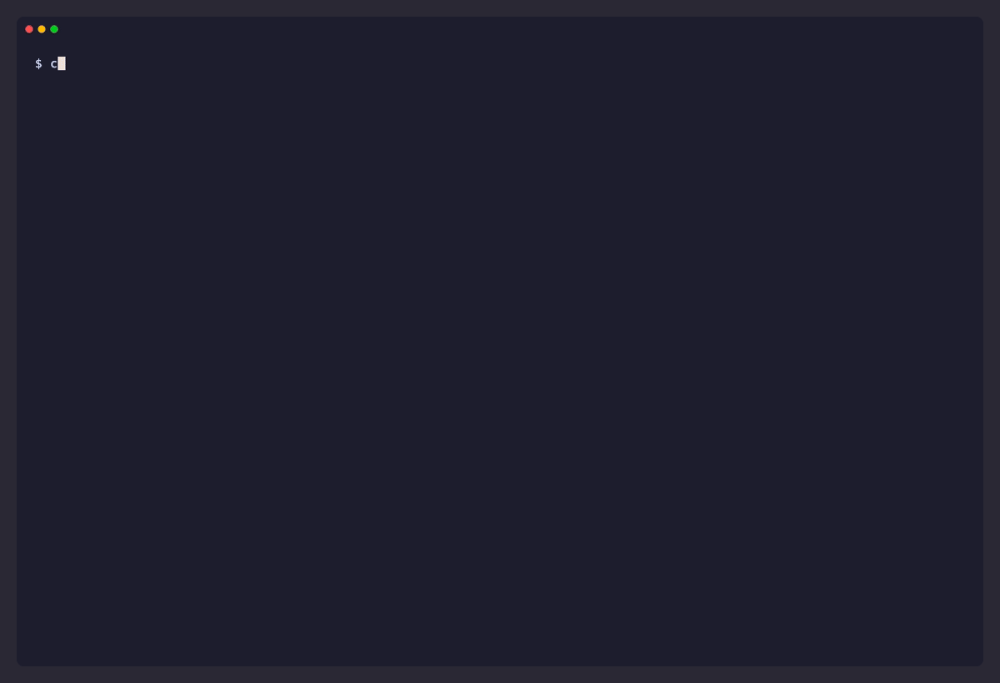

# checkmate

[](https://github.com/rtulke/checkmate/actions/workflows/ci.yml)
[](https://github.com/rtulke/checkmate/actions/workflows/release.yml)
[](https://rtulke.github.io/checkmate/)

**Compliance checks as commands.** Every check is a shell command and a condition on its result, written in YAML. checkmate runs on Linux, macOS and Windows, checks network devices and remote servers from a management host, and ships nearly **15,000 checks** for CIS Benchmarks, DISA STIGs, BSI IT-Grundschutz, Si001 and MITRE ATT&CK.

[Deutsche Version](README_de.md) · [Documentation](https://rtulke.github.io/checkmate/) · [Security standards](https://rtulke.github.io/checkmate/standards/) · [Examples](https://rtulke.github.io/checkmate/examples/)



```yaml
- id: SSH-001
  name: Root login over SSH is disabled
  severity: high
  run: sshd -T | awk '$1 == "permitrootlogin" {print $2}'
  expect: "== no"
```

```console
$ checkmate run baseline.yml -v
PASS   SSH-001   Root login over SSH is disabled
FAIL   FS-001    /tmp has at least 500 MB free    [high]  expected stdout >= "500", got "312"

2 checks · 1 passed · 1 failed · 0 warnings · 0 errors · 0 skipped · 0 n/a · 42ms
Score  █████████████████░░░░░░░░░░░░░ 58.8%
Result NOT COMPLIANT
```

## Why

Most compliance tools need a plugin or module for every kind of check. checkmate needs one thing: a command. If you can test it in a shell, you can turn it into a check, and you can copy any check straight into a terminal to see what it does.

- **Readable**: YAML with Jinja2 variables, loops and reusable snippets, familiar from Ansible.
- **Portable**: one static binary; platform variants pick the right command for RHEL, Debian, SUSE, Alpine, macOS or PowerShell.
- **Fail-closed**: a check that cannot be evaluated (timeout, missing tool, unexpected exit code) is an error, and errors always make a run non-compliant.
- **Prioritized**: severities, a `--fail-on` threshold with warnings below it, a weighted compliance score, and waivers for accepted deviations.
- **Independent checks**: every check collects its own data; no shared scans or caches between checks.
- **Ready for pipelines**: exit codes, colored text, JSON, JUnit XML and ATT&CK Navigator layers.

## Install

| Method | Command |
|---|---|
| Debian, Ubuntu | `sudo apt install ./checkmate_<version>-1_<arch>.deb` |
| Fedora, RHEL/Rocky/Alma/Oracle, openSUSE | `sudo dnf install ./checkmate-<version>-1.<arch>.rpm` (`zypper install` on openSUSE) |
| Homebrew (macOS, Linux) | `brew install rtulke/checkmate/checkmate` |
| Binary (Linux, macOS, Windows) | download from the [releases](https://github.com/rtulke/checkmate/releases) |
| Go | `go install github.com/rtulke/checkmate/cmd/checkmate@latest` |

The `.deb` and `.rpm` packages exist for amd64 and arm64 and are installed and run on Debian 12/13, Ubuntu 24.04/26.04, Fedora 43/44, EL 9/10 and openSUSE Leap 16.0/Tumbleweed before every release. Packages and Homebrew install the man pages `checkmate(1)` and `checkmate-policy(5)` and all policies below `/usr/share/checkmate/` (Homebrew: `$(brew --prefix)/share/checkmate/`). See [installation](https://rtulke.github.io/checkmate/getting-started/installation/).

## Quick start

```bash
sudo checkmate run /usr/share/checkmate/cis/rhel9.yml --tags cis-level1-server
checkmate run examples/getting-started.yml  # run a policy
checkmate list -v examples/system/ssh.yml   # show the commands for this host
checkmate validate my-policy.yml            # check a policy without running it
checkmate run baseline.yml -v               # with severity and reasons (-vv details, -vvv debug)
checkmate run baseline.yml --tags ssh --fail-on high --junit-out junit.xml
```

## Security standards

| Standard | Platforms | Policies | Rules | Checks | Coverage |
|---|---|---:|---:|---:|---|
| [CIS Benchmarks Linux](https://rtulke.github.io/checkmate/cis/) | RHEL 7–10, Debian 11–13, Ubuntu 18.04–26.04, SUSE 15/16, Amazon Linux 2/2023/2027 | 17 | 4,841 | 8,360 | every automated recommendation of the Ansible Lockdown audits, Level 1/2, server/workstation |
| [CIS Benchmarks Windows](https://rtulke.github.io/checkmate/cis/) | Windows 11, Windows Server 2019/2022/2025 | 4 | 1,780 | 1,921 | every automated recommendation, member server, domain controller, standalone; not Server 2016 |
| [CIS Benchmarks macOS](https://rtulke.github.io/checkmate/cis/) | macOS 14, 15, 26 | 3 | 275 | 341 | every CIS rule of the macOS Security Compliance Project with an automated check |
| [CIS PostgreSQL](https://rtulke.github.io/checkmate/cis/postgresql/) | PostgreSQL 12 and later | 1 | 46 | 51 | automatable recommendations; privilege design and backups need a review |
| [CIS Apache HTTP Server](https://rtulke.github.io/checkmate/cis/apache/) | Apache 2.4 (RHEL, Debian, SUSE) | 1 | 70 | 70 | automatable recommendations, Level 1/2 |
| [DISA STIG](https://rtulke.github.io/checkmate/stig/) | RHEL 7–10, Ubuntu 22.04/24.04, Amazon Linux 2023 | 7 | 1,935 | 3,034 | every automated rule of the Ansible Lockdown audits, CAT I–III |
| [BSI IT-Grundschutz](https://rtulke.github.io/checkmate/examples/compliance/bsi-grundschutz/) | Linux servers (SYS.1.1, SYS.1.3) | 1 | | 53 | host-verifiable requirements, Basis/Standard/Hoch |
| [Si001 IT-Grundschutz Bund (CH)](https://rtulke.github.io/checkmate/examples/compliance/si001/) | Linux, macOS and Windows clients | 1 | | 35 | host-verifiable requirements, Grundschutz and increased protection (Schuban) |
| [MITRE ATT&CK](https://rtulke.github.io/checkmate/examples/attack/) | Linux, Windows, macOS | 3 | 63 techniques | 75 | traces and mitigations of selected techniques, ATT&CK Navigator layers |
| **Total** | | **38** | | **13,940** | |

Rules are recommendations, STIG rules or techniques; one rule can need several checks. Rules that cannot be automated (organizational measures, manual reviews) are not included. NIST SP 800-53, NIST 800-171 and CMMC are covered through the mappings of the STIG and macOS policies (`--tags nist-800-53r5-moderate`). Accepted deviations go into [waivers](https://rtulke.github.io/checkmate/reference/waivers/), not into the policies.

## A policy in one minute

```yaml
name: Web server baseline

vars:
  required_services: [nginx, chronyd]

snippets:
  pkg_installed:
    rhel,suse: rpm -q --quiet {{ arg }}
    debian: dpkg -s {{ arg }} >/dev/null 2>&1

checks:
  - id: "SVC-{{ item }}"                     # one check per loop item
    name: "{{ item }} is running"
    loop: "{{ required_services }}"
    run: systemctl is-active {{ item }}
    expect: "== active"

  - id: PKG-TELNET
    name: telnet is not installed
    severity: high
    run: { use: pkg_installed, arg: telnet }
    expect: false

  - id: DISK-TMP
    name: /tmp has at least 500 MB free
    run: df -Pm /tmp | awk 'NR == 2 {print $4}'
    expect: ">= 500"

  - id: NO-NOPASSWD
    name: No passwordless sudo rules
    when: facts.is_root
    run: grep -rh 'NOPASSWD' /etc/sudoers /etc/sudoers.d
    allow_rc: [0, 1]                         # grep exits 1 when nothing matches
    expect: empty
```

`expect` understands `true`/`false` (exit code), `==`, `!=`, `>`, `>=`, `<`, `<=`, `!>`, `!<`, regular expressions (`~`, `!~`), lists (`in`, `!in`), `empty`, line counts and stderr. These building blocks combine with `all`, `any`, `not`, per-line checks (`each`, `some`, `none`) and conditional expectations:

```yaml
expect: { each: "< 90" }                     # every line of the output
expect: { none: "~ ^permitrootlogin yes" }   # no line may match
expect:
  if: { stdout: "~ ^ubuntu" }                # a different rule per distribution
  then: "~ 24\\."
  else: "~ 12"
```

See the [reference](https://rtulke.github.io/checkmate/reference/expect/) and `man checkmate-policy`.

Findings that are real but accepted go into a waiver file with a reason and an expiry date. Waived checks still run and stay visible as `WAIVED`, but do not fail the run; after `until` they count again:

```yaml
waivers:
  - id: SSH-PORT
    reason: Port 2222 by decision of the network team (ticket SEC-1234)
    until: 2027-06-30
```

```bash
checkmate run baseline.yml --waivers waivers.yml
```

See [waivers](https://rtulke.github.io/checkmate/reference/waivers/).

## Examples

58 tested policies with 1,118 checks, organized like the documentation:

| Category | Policies | Checks | Contents |
|---|---:|---:|---|
| [Getting started](examples/getting-started.yml) | 1 | 11 | a first policy |
| [Platforms](examples/platforms) | 6 | 60 | generic Linux, RHEL family, Debian/Ubuntu, SUSE, macOS, Windows |
| [System](examples/system) | 12 | 136 | users, sudo, SSH, PAM, services, kernel, boot, time, logging, packages, cron, SELinux/AppArmor |
| [Files](examples/files) | 6 | 63 | permissions, content, integrity, searches, mounts, disk space |
| [Network](examples/network) | 5 | 36 | interfaces, ports, firewalls, DNS, TLS |
| [Hardware](examples/hardware) | 3 | 19 | CPU, memory, disks, RAID, virtualization, IPMI |
| [Network devices](examples/network-devices) | 4 | 42 | Cisco IOS, Juniper Junos, Arista EOS, SNMP |
| [Remote hosts](examples/remote) | 1 | 12 | Linux servers over SSH |
| [Applications](examples/applications) | 11 | 145 | Docker, Kubernetes, nginx, Apache, PHP, PostgreSQL, MySQL, Redis, MongoDB, web endpoints |
| [Cloud](examples/cloud) | 1 | 9 | AWS, Azure and Google Cloud instances: metadata service, agents, credentials |
| [Server validation](examples/validation) | 1 | 19 | goss-style validation of a server role: users, packages, ports, files, HTTP |
| [Compliance](examples/compliance) | 4 | 491 | BSI IT-Grundschutz, Si001, a broad Linux hardening baseline modelled on OpenSCAP and CIS, a managed-RHEL baseline |
| [MITRE ATT&CK](examples/attack) | 3 | 75 | traces and mitigations of ATT&CK techniques on Linux, Windows and macOS |

## Platforms and testing

| | Runs on | Tested in CI |
|---|---|---|
| Linux | any distribution with a POSIX shell (bash or sh, also BusyBox) | examples on Rocky Linux 8/9, Debian 12, Ubuntu 24.04, openSUSE Leap 15, Alpine; CIS and STIG policies on 16 distributions in containers; hardened PostgreSQL and Apache servers; planted ATT&CK artifacts |
| Windows | Windows 10/11, Windows Server 2016 and later (PowerShell 5.1 or 7) | CIS and ATT&CK policies on real Windows Server 2022 and 2025; every PowerShell command through the PowerShell parser |
| macOS | macOS 13 and later | unit tests and Homebrew installation on macOS runners |
| Network devices, remote servers | over SSH or SNMP from a management host | syntax of every command |

## Development

```bash
make build          # bin/checkmate
make test           # unit tests, example validation, escape tests
make lint           # gofmt and go vet
make test-linux     # run all examples in Linux containers (docker)
make test-cis       # run every CIS and STIG policy on its platform (docker)
make docs-serve     # documentation on http://127.0.0.1:8000 (mkdocs-material)
make dist           # binaries for Linux, macOS and Windows
make packages       # .deb and .rpm for amd64 and arm64
make cis-import     # regenerate the CIS policies (gh)
make stig-import    # regenerate the STIG policies (gh)
vhs docs/demo.tape  # re-record the terminal demo (vhs, docker)
```

The project layout:

```text
cmd/checkmate/      command line interface
internal/           engine, policy loader, expectations, runner, reports, facts
cis/, stig/         generated CIS and STIG policies, hand-written PostgreSQL and Apache
examples/           example policies, BSI, Si001, MITRE ATT&CK (also the source of the docs)
docs/               documentation site (MkDocs Material)
packaging/          man pages, nfpm package description, install tests
Formula/            Homebrew formula (tap rtulke/checkmate)
tools/              cis-import (CIS, STIG, Windows), mscp-import (macOS), gendocs
test/               container harnesses for Linux, Windows analysis and attack simulations
```

## License

Apache License 2.0, see [LICENSE](LICENSE). The generated policies are derived from the Ansible Lockdown audits (MIT, [cis/NOTICE](cis/NOTICE), [stig/NOTICE](stig/NOTICE)) and the macOS Security Compliance Project (CC BY 4.0); ATT&CK data is used with the permission of The MITRE Corporation ([examples/attack/NOTICE](examples/attack/NOTICE)). CIS Benchmarks is a trademark of the Center for Internet Security; the policies contain no benchmark text.
