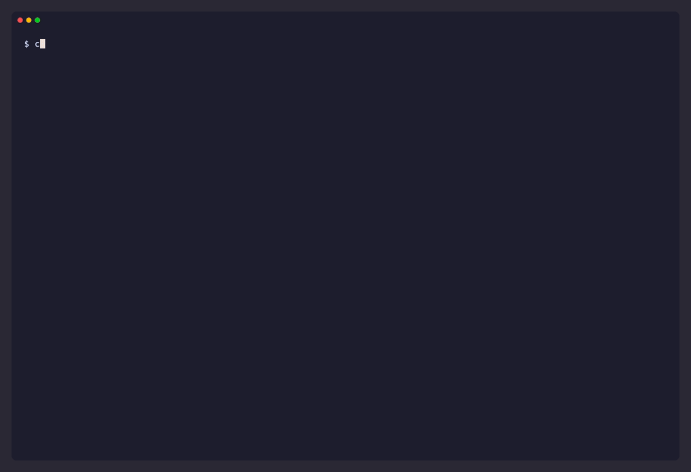

# checkmate

[](https://github.com/rtulke/checkmate/actions/workflows/ci.yml)
[](https://github.com/rtulke/checkmate/actions/workflows/release.yml)
[](https://rtulke.github.io/checkmate/)

**Compliance-Checks als Kommandos.** Jeder Check ist ein Shell-Kommando und eine Bedingung an dessen Ergebnis, geschrieben in YAML. checkmate läuft auf Linux, macOS und Windows, prüft Netzwerkgeräte und entfernte Server von einem Management-Host aus und bringt mehr als **15.000 Checks** für CIS Benchmarks, DISA STIGs, BSI IT-Grundschutz, Si001 und MITRE ATT&CK mit.

[English version](README.md) · [Dokumentation](https://rtulke.github.io/checkmate/) · [Sicherheitsstandards](https://rtulke.github.io/checkmate/standards/) · [Beispiele](https://rtulke.github.io/checkmate/examples/)



```yaml
- id: SSH-001
  name: Root login over SSH is disabled
  severity: high
  run: sshd -T | awk '$1 == "permitrootlogin" {print $2}'
  expect: "== no"
```

```console
$ checkmate run baseline.yml -v
PASS   SSH-001   Root login over SSH is disabled
FAIL   FS-001    /tmp has at least 500 MB free    [high]  expected stdout >= "500", got "312"

2 checks · 1 passed · 1 failed · 0 warnings · 0 errors · 0 skipped · 0 n/a · 42ms
Score  █████████████████░░░░░░░░░░░░░ 58.8%
Result NOT COMPLIANT
```

## Warum

Die meisten Compliance-Werkzeuge brauchen für jede Art von Prüfung ein Plugin oder Modul. checkmate braucht genau eines: ein Kommando. Was sich in einer Shell prüfen lässt, lässt sich als Check schreiben, und jeder Check lässt sich direkt in ein Terminal kopieren, um zu sehen, was er tut.

- **Lesbar**: YAML mit Jinja2-Variablen, Schleifen und wiederverwendbaren Snippets, vertraut aus Ansible.
- **Portabel**: ein statisches Binary; Plattformvarianten wählen das passende Kommando für RHEL, Debian, SUSE, Alpine, macOS oder PowerShell.
- **Fail-closed**: Ein Check, der sich nicht auswerten lässt (Timeout, fehlendes Werkzeug, unerwarteter Exit-Code), ist ein Fehler, und Fehler machen einen Lauf immer nicht konform.
- **Priorisiert**: Schweregrade, eine `--fail-on`-Schwelle mit Warnungen darunter, ein gewichteter Compliance-Score und Waivers für akzeptierte Abweichungen.
- **Unabhängige Checks**: Jeder Check holt seine Daten selbst; keine gemeinsamen Scans oder Caches zwischen Checks.
- **Berichte für alle**: HTML und PDF für Auditoren, CSV für Tabellen, JSON Lines und Syslog für SIEMs, Prometheus-Metriken, JUnit für CI, XCCDF/ARF für SCAP-Werkzeuge und Layer für den ATT&CK Navigator; Berichte vieler Hosts lassen sich zusammenführen, und `checkmate diff` zeigt, was sich geändert hat.

## Installation

| Weg | Kommando |
|---|---|
| Debian, Ubuntu | `sudo apt install ./checkmate_<version>-1_<arch>.deb` |
| Fedora, RHEL/Rocky/Alma/Oracle, openSUSE | `sudo dnf install ./checkmate-<version>-1.<arch>.rpm` (`zypper install` unter openSUSE) |
| Homebrew (macOS, Linux) | `brew tap rtulke/checkmate https://github.com/rtulke/checkmate && brew install checkmate` |
| Binary (Linux, macOS, Windows) | Download von den [Releases](https://github.com/rtulke/checkmate/releases) |
| Go | `go install github.com/rtulke/checkmate/cmd/checkmate@latest` |

Die `.deb`- und `.rpm`-Pakete gibt es für amd64 und arm64; vor jedem Release werden sie auf Debian 12/13, Ubuntu 24.04/26.04, Fedora 43/44, EL 9/10 und openSUSE Leap 16.0/Tumbleweed installiert und ausgeführt. Pakete und Homebrew installieren die Manpages `checkmate(1)` und `checkmate-policy(5)` sowie alle Policies unter `/usr/share/checkmate/` (Homebrew: `$(brew --prefix)/share/checkmate/`). Siehe [Installation](https://rtulke.github.io/checkmate/getting-started/installation/).

## Schnellstart

```bash
sudo checkmate run /usr/share/checkmate/cis/rhel9.yml --tags cis-level1-server
checkmate run examples/getting-started.yml  # eine Policy ausführen
checkmate list -v examples/system/ssh.yml   # die Kommandos für diesen Host anzeigen
checkmate validate my-policy.yml            # eine Policy prüfen, ohne sie auszuführen
checkmate run baseline.yml -v               # mit Schweregrad und Begründung (-vv Details, -vvv Debug)
checkmate run baseline.yml --tags ssh --fail-on high --export junit,html -o report
```

## Sicherheitsstandards

| Standard | Plattformen | Policies | Regeln | Checks | Abdeckung |
|---|---|---:|---:|---:|---|
| [CIS Benchmarks Linux](https://rtulke.github.io/checkmate/cis/) | RHEL 7–10, Debian 11–13, Ubuntu 18.04–26.04, SUSE 15/16, Amazon Linux 2/2023/2027 | 17 | 4.841 | 8.360 | alle automatisierten Empfehlungen der Ansible-Lockdown-Audits, Level 1/2, Server/Workstation |
| [CIS Benchmarks Windows](https://rtulke.github.io/checkmate/cis/) | Windows 11, Windows Server 2019/2022/2025 | 4 | 1.780 | 1.921 | alle automatisierten Empfehlungen, Member Server, Domain Controller, Standalone; nicht Server 2016 |
| [CIS Benchmarks macOS](https://rtulke.github.io/checkmate/cis/) | macOS 14, 15, 26 | 3 | 275 | 341 | alle CIS-Regeln des macOS Security Compliance Project mit automatisierter Prüfung |
| [CIS PostgreSQL](https://rtulke.github.io/checkmate/cis/postgresql/) | PostgreSQL ab 12 | 1 | 46 | 51 | automatisierbare Empfehlungen; Rechtekonzept und Backups brauchen eine Prüfung von Hand |
| [CIS Apache HTTP Server](https://rtulke.github.io/checkmate/cis/apache/) | Apache 2.4 (RHEL, Debian, SUSE) | 1 | 70 | 70 | automatisierbare Empfehlungen, Level 1/2 |
| [DISA STIG](https://rtulke.github.io/checkmate/stig/) | RHEL 7–10, Ubuntu 22.04/24.04, Amazon Linux 2023 | 7 | 1.935 | 3.034 | alle automatisierten Regeln der Ansible-Lockdown-Audits, CAT I–III |
| [BSI IT-Grundschutz](https://rtulke.github.io/checkmate/examples/compliance/bsi-grundschutz/) | Linux-Server (SYS.1.1, SYS.1.3) | 1 | | 53 | auf dem Host prüfbare Anforderungen, Basis/Standard/Hoch |
| [Si001 IT-Grundschutz Bund (CH)](https://rtulke.github.io/checkmate/examples/compliance/si001/) | Linux, macOS- und Windows-Clients | 1 | | 35 | auf dem Host prüfbare Anforderungen, Grundschutz und erhöhter Schutzbedarf (Schuban) |
| [MITRE ATT&CK](https://rtulke.github.io/checkmate/examples/attack/) | Linux, Windows, macOS | 3 | 63 Techniken | 75 | Spuren und Gegenmaßnahmen ausgewählter Techniken, Layer für den ATT&CK Navigator |
| **Gesamt** | | **38** | | **13.940** | |

Regeln sind Empfehlungen, STIG-Regeln oder Techniken; eine Regel kann mehrere Checks brauchen. Nicht automatisierbare Regeln (organisatorische Maßnahmen, Prüfungen von Hand) sind nicht enthalten. NIST SP 800-53, NIST 800-171 und CMMC sind über die Zuordnungen der STIG- und macOS-Policies abgedeckt (`--tags nist-800-53r5-moderate`). Akzeptierte Abweichungen gehören in [Waivers](https://rtulke.github.io/checkmate/reference/waivers/), nicht in die Policies.

## Eine Policy in einer Minute

```yaml
name: Web server baseline

vars:
  required_services: [nginx, chronyd]

snippets:
  pkg_installed:
    rhel,suse: rpm -q --quiet {{ arg }}
    debian: dpkg -s {{ arg }} >/dev/null 2>&1

checks:
  - id: "SVC-{{ item }}"                     # ein Check pro Schleifenelement
    name: "{{ item }} is running"
    loop: "{{ required_services }}"
    run: systemctl is-active {{ item }}
    expect: "== active"

  - id: PKG-TELNET
    name: telnet is not installed
    severity: high
    run: { use: pkg_installed, arg: telnet }
    expect: false

  - id: DISK-TMP
    name: /tmp has at least 500 MB free
    run: df -Pm /tmp | awk 'NR == 2 {print $4}'
    expect: ">= 500"

  - id: NO-NOPASSWD
    name: No passwordless sudo rules
    when: facts.is_root
    run: grep -rh 'NOPASSWD' /etc/sudoers /etc/sudoers.d
    allow_rc: [0, 1]                         # grep endet mit 1, wenn nichts passt
    expect: empty
```

`expect` versteht `true`/`false` (Exit-Code), `==`, `!=`, `>`, `>=`, `<`, `<=`, `!>`, `!<`, reguläre Ausdrücke (`~`, `!~`), Listen (`in`, `!in`), `empty`, Zeilenzahlen und stderr. Diese Bausteine lassen sich mit `all`, `any`, `not`, zeilenweisen Prüfungen (`each`, `some`, `none`) und bedingten Erwartungen kombinieren:

```yaml
expect: { each: "< 90" }                     # jede Zeile der Ausgabe
expect: { none: "~ ^permitrootlogin yes" }   # keine Zeile darf passen
expect:
  if: { stdout: "~ ^ubuntu" }                # eine andere Regel je Distribution
  then: "~ 24\\."
  else: "~ 12"
```

Siehe die [Referenz](https://rtulke.github.io/checkmate/reference/expect/) und `man checkmate-policy`.

Echte, aber akzeptierte Abweichungen kommen in eine Waiver-Datei mit Begründung und Ablaufdatum. Gewaiverte Checks laufen weiter und bleiben als `WAIVED` sichtbar, lassen den Lauf aber nicht scheitern; nach `until` zählen sie wieder:

```yaml
waivers:
  - id: SSH-PORT
    reason: Port 2222 by decision of the network team (ticket SEC-1234)
    until: 2027-06-30
```

```bash
checkmate run baseline.yml --waivers waivers.yml
```

Siehe [Waivers](https://rtulke.github.io/checkmate/reference/waivers/).

## Berichte und Exporte

Ein einziges Flag schreibt beliebig viele Formate neben der Konsolenausgabe. `checkmate export` wandelt gespeicherte JSON-Berichte um und führt sie zusammen, `checkmate diff` vergleicht Berichte oder Policies.

```bash
checkmate run baseline.yml --export html,pdf,json -o reports/      # reports/checkmate-<host>-<zeit>.*
checkmate run baseline.yml -q --export prom,syslog:tls://siem.example.com -o /var/lib/checkmate/latest
checkmate export -f html,pdf,csv -o fleet reports/*.json           # ein Bericht für alle Hosts
checkmate diff montag.json dienstag.json                           # neue Probleme, behobene Checks, Score
checkmate diff baseline-1.4.yml baseline-1.5.yml                   # hinzugefügte, entfernte, geänderte Checks
```

| Format | Für |
|---|---|
| `text`, `html`, `pdf` | Menschen: Konsole, filterbare HTML-Einzeldatei, druckbares PDF (eingebaut, ohne externe Werkzeuge) |
| `json`, `csv` | Archive, Skripte und Tabellenkalkulationen |
| `jsonl`, `syslog` | SIEMs: ein JSON-Ereignis pro Check, als Datei oder an Syslog (lokal, UDP, TCP, TLS) |
| `prom` | Prometheus über den Textfile-Collector des node_exporter |
| `junit` | Testansichten von GitLab, GitHub, Jenkins und Azure DevOps |
| `xccdf`, `arf` | SCAP-Werkzeuge; gültig für OpenSCAP, das sie wie eigene Ergebnisse darstellt |
| `attack` | Layer für den MITRE ATT&CK Navigator |

Siehe [Berichte und Exporte](https://rtulke.github.io/checkmate/reference/exports/).

## Beispiele

66 getestete Policies mit 1.193 Checks, gegliedert wie die Dokumentation:

| Kategorie | Policies | Checks | Inhalt |
|---|---:|---:|---|
| [Erste Schritte](examples/getting-started.yml) | 1 | 11 | eine erste Policy |
| [Plattformen](examples/platforms) | 6 | 60 | allgemeines Linux, RHEL-Familie, Debian/Ubuntu, SUSE, macOS, Windows |
| [System](examples/system) | 12 | 136 | Benutzer, sudo, SSH, PAM, Dienste, Kernel, Boot, Zeit, Logging, Pakete, cron, SELinux/AppArmor |
| [Dateien](examples/files) | 6 | 63 | Berechtigungen, Inhalte, Integrität, Suchen, Mounts, Speicherplatz |
| [Netzwerk](examples/network) | 5 | 36 | Interfaces, Ports, Firewalls, DNS, TLS |
| [Hardware](examples/hardware) | 3 | 19 | CPU, Speicher, Platten, RAID, Virtualisierung, IPMI |
| [Netzwerkgeräte](examples/network-devices) | 4 | 42 | Cisco IOS, Juniper Junos, Arista EOS, SNMP |
| [Entfernte Hosts](examples/remote) | 1 | 12 | Linux-Server über SSH |
| [Anwendungen](examples/applications) | 11 | 145 | Docker, Kubernetes, nginx, Apache, PHP, PostgreSQL, MySQL, Redis, MongoDB, Web-Endpunkte |
| [Linux-Dienste](examples/services) | 8 | 75 | Postfix, NFS, FTP (vsftpd, ProFTPD), BIND, DHCP (Kea, ISC dhcpd), Dovecot, Samba, OpenLDAP |
| [Cloud](examples/cloud) | 1 | 9 | Instanzen in AWS, Azure und Google Cloud: Metadatendienst, Agenten, Zugangsdaten |
| [Server-Validierung](examples/validation) | 1 | 19 | Validierung einer Server-Rolle im Stil von goss: Benutzer, Pakete, Ports, Dateien, HTTP |
| [Compliance](examples/compliance) | 4 | 491 | BSI IT-Grundschutz, Si001, eine umfassende Linux-Hardening-Baseline nach dem Vorbild von OpenSCAP und CIS, eine Managed-RHEL-Baseline |
| [MITRE ATT&CK](examples/attack) | 3 | 75 | Spuren und Gegenmaßnahmen von ATT&CK-Techniken auf Linux, Windows und macOS |

## Plattformen und Tests

| | Läuft auf | Getestet in der CI |
|---|---|---|
| Linux | jeder Distribution mit POSIX-Shell (bash oder sh, auch BusyBox) | Beispiele auf Rocky Linux 8/9, Debian 12, Ubuntu 24.04, openSUSE Leap 15, Alpine; CIS- und STIG-Policies auf 16 Distributionen in Containern; gehärtete PostgreSQL- und Apache-Server; Postfix, NFS, vsftpd, BIND, Kea, Dovecot, Samba und OpenLDAP in Standard- und gehärteter Konfiguration; gepflanzte ATT&CK-Artefakte; XCCDF/ARF mit OpenSCAP, Metriken mit promtool, Syslog mit rsyslog validiert |
| Windows | Windows 10/11, Windows Server ab 2016 (PowerShell 5.1 oder 7) | CIS- und ATT&CK-Policies auf echtem Windows Server 2022 und 2025; jedes PowerShell-Kommando durch den PowerShell-Parser |
| macOS | macOS ab 13 | Unit-Tests und Homebrew-Installation auf macOS-Runnern |
| Netzwerkgeräte, entfernte Server | über SSH oder SNMP von einem Management-Host | Syntax jedes Kommandos |

## Entwicklung

```bash
make build          # bin/checkmate
make test           # Unit-Tests, Validierung der Beispiele, Escape-Tests
make lint           # gofmt und go vet
make test-linux     # alle Beispiele in Linux-Containern ausführen (docker)
make test-cis       # jede CIS- und STIG-Policy auf ihrer Plattform ausführen (docker)
make docs-serve     # Dokumentation auf http://127.0.0.1:8000 (mkdocs-material)
make dist           # Binaries für Linux, macOS und Windows
make packages       # .deb und .rpm für amd64 und arm64
make cis-import     # CIS-Policies neu erzeugen (gh)
make stig-import    # STIG-Policies neu erzeugen (gh)
vhs docs/demo.tape  # Terminal-Demo neu aufnehmen (vhs, docker)
```

Der Aufbau des Projekts:

```text
cmd/checkmate/      Kommandozeile
internal/           Engine, Policy-Loader, Erwartungen, Runner, Reports, Facts
cis/, stig/         erzeugte CIS- und STIG-Policies, PostgreSQL und Apache von Hand
examples/           Beispiel-Policies, BSI, Si001, MITRE ATT&CK (auch Quelle der Doku)
docs/               Dokumentationsseite (MkDocs Material)
packaging/          Manpages, nfpm-Paketbeschreibung, Installationstests
Formula/            Homebrew-Formel (Tap rtulke/checkmate)
tools/              cis-import (CIS, STIG, Windows), mscp-import (macOS), gendocs
test/               Container-Testumgebungen für Linux, Windows-Analyse und Angriffssimulationen
```

## Referenzen und Quellen

### Unterstützte Standards

| Standard | Herausgeber | In checkmate |
|---|---|---|
| [CIS Benchmarks](https://www.cisecurity.org/cis-benchmarks) | Center for Internet Security | `cis/`: Linux, Windows, macOS, PostgreSQL, Apache httpd |
| [CIS Controls v8](https://www.cisecurity.org/controls) | Center for Internet Security | in den Beschreibungen der CIS-Linux-Checks genannt |
| [DISA STIGs](https://public.cyber.mil/stigs/) | US Defense Information Systems Agency | `stig/`: RHEL, Ubuntu, Amazon Linux |
| [NIST SP 800-53 Rev. 5](https://csrc.nist.gov/pubs/sp/800/53/r5/upd1/final) | NIST | Control-IDs in den CIS-, STIG- und macOS-Checks; Tags `nist-800-53r5-*` (macOS) |
| [NIST SP 800-171](https://csrc.nist.gov/pubs/sp/800/171/r3/final) | NIST | Tag `nist-800-171` (macOS) |
| [CMMC](https://dodcio.defense.gov/CMMC/) | US-Verteidigungsministerium | Tags `cmmc-level-1`, `cmmc-level-2` (macOS) |
| [IT-Grundschutz-Kompendium](https://www.bsi.bund.de/DE/Themen/Unternehmen-und-Organisationen/Standards-und-Zertifizierung/IT-Grundschutz/IT-Grundschutz-Kompendium/IT-Grundschutz-Bausteine/Bausteine_Download_Edition_node.html), Edition 2023 | BSI (Deutschland) | `examples/compliance/bsi-grundschutz.yml`: SYS.1.1, SYS.1.3 |
| [Si001 IT-Grundschutz in der Bundesverwaltung](https://www.sepos.admin.ch/de/sicherheitsverfahren), V5.1, und die [Schutzbedarfsanalyse (Schuban)](https://www.bacs.admin.ch/de/beurteilung-des-schutzbedarfs) | SEPOS (früher BACS), Schweiz | `examples/compliance/si001.yml` |
| [MITRE ATT&CK](https://attack.mitre.org/) Enterprise 20.1 | The MITRE Corporation | `examples/attack/`, `--export attack` |

### Quellen der Checks

| Quelle | Verwendet für | Lizenz |
|---|---|---|
| [Ansible Lockdown](https://github.com/ansible-lockdown) CIS-Audits: [RHEL7](https://github.com/ansible-lockdown/RHEL7-CIS-Audit), [RHEL8](https://github.com/ansible-lockdown/RHEL8-CIS-Audit), [RHEL9](https://github.com/ansible-lockdown/RHEL9-CIS-Audit), [RHEL10](https://github.com/ansible-lockdown/RHEL10-CIS-Audit), [DEBIAN11](https://github.com/ansible-lockdown/DEBIAN11-CIS-Audit), [DEBIAN12](https://github.com/ansible-lockdown/DEBIAN12-CIS-Audit), [DEBIAN13](https://github.com/ansible-lockdown/DEBIAN13-CIS-Audit), [UBUNTU20](https://github.com/ansible-lockdown/UBUNTU20-CIS-Audit), [UBUNTU22](https://github.com/ansible-lockdown/UBUNTU22-CIS-Audit), [UBUNTU24](https://github.com/ansible-lockdown/UBUNTU24-CIS-Audit), [UBUNTU26](https://github.com/ansible-lockdown/UBUNTU26-CIS-Audit), [SUSE15](https://github.com/ansible-lockdown/SUSE15-CIS-Audit), [SUSE16](https://github.com/ansible-lockdown/SUSE16-CIS-Audit), [AMAZON2](https://github.com/ansible-lockdown/AMAZON2-CIS-Audit), [AMAZON2023](https://github.com/ansible-lockdown/AMAZON2023-CIS-Audit), [AMAZON2027](https://github.com/ansible-lockdown/AMAZON2027-CIS-Audit), [UBUNTU18](https://github.com/ansible-lockdown/UBUNTU18-CIS-Audit) | CIS-Policies für Linux, konvertiert mit `tools/cis-import` | MIT |
| Ansible-Lockdown-Audits für Windows: [Windows-11](https://github.com/ansible-lockdown/Windows-11-CIS-Audit), [Windows-2019](https://github.com/ansible-lockdown/Windows-2019-CIS-Audit), [Windows-2022](https://github.com/ansible-lockdown/Windows-2022-CIS-Audit), [Windows-2025](https://github.com/ansible-lockdown/Windows-2025-CIS-Audit) | CIS-Policies für Windows | MIT |
| Ansible-Lockdown-STIG-Audits: [RHEL7](https://github.com/ansible-lockdown/RHEL7-STIG-Audit), [RHEL8](https://github.com/ansible-lockdown/RHEL8-STIG-Audit), [RHEL9](https://github.com/ansible-lockdown/RHEL9-STIG-Audit), [RHEL10](https://github.com/ansible-lockdown/RHEL10-STIG-Audit), [UBUNTU22](https://github.com/ansible-lockdown/UBUNTU22-STIG-Audit), [UBUNTU24](https://github.com/ansible-lockdown/UBUNTU24-STIG-Audit), [AMAZON2023](https://github.com/ansible-lockdown/AMAZON2023-STIG-Audit) | DISA-STIG-Policies | MIT |
| Ansible-Lockdown-Rollen [POSTGRES-12-CIS](https://github.com/ansible-lockdown/POSTGRES-12-CIS), [APACHE-2.4-CIS](https://github.com/ansible-lockdown/APACHE-2.4-CIS) | Anforderungen und Level der von Hand geschriebenen PostgreSQL- und Apache-Policies | MIT |
| [macOS Security Compliance Project](https://github.com/usnistgov/macos_security) ([Dokumentation](https://pages.nist.gov/macos_security/)) | CIS-Policies für macOS, konvertiert mit `tools/mscp-import` | CC BY 4.0 |
| BSI IT-Grundschutz-Kompendium, Bausteine SYS.1.1 und SYS.1.3 | Anforderungs-IDs der BSI-Policy (eigene Formulierungen) | Nutzungsbedingungen des BSI |
| Si001 V5.1 und der Schuban-Leitfaden des SEPOS | Anforderungen der Si001-Policy | Schweizerische Bundesverwaltung |
| [ATT&CK-STIX-Daten](https://github.com/mitre-attack/attack-stix-data) | Technikliste zur Prüfung der `attack-*`-Tags | Nutzungsbedingungen von ATT&CK |

### Verwandte Werkzeuge und Vorbilder

| Werkzeug | Bezug zu checkmate |
|---|---|
| [CIS-CAT Pro](https://www.cisecurity.org/cybersecurity-tools/cis-cat-pro) | das Prüfwerkzeug des CIS; dessen lizenzierter Inhalt wird nicht verwendet, checkmate deckt die Benchmark-Empfehlungen über die oben genannten Quellen ab |
| [OpenSCAP](https://www.open-scap.org/) und [ComplianceAsCode / SCAP Security Guide](https://github.com/ComplianceAsCode/content) | Vorbild für die Linux-Hardening-Baseline und die httpd-Checks |
| [Wazuh SCA](https://github.com/wazuh/wazuh/tree/main/ruleset/sca) | Vorbild für Checks der Hardening-Baseline und der Anwendungsbeispiele |
| [goss](https://github.com/goss-org/goss) | Format der Ansible-Lockdown-Audits; Vorbild für die Beispiele zur Server-Validierung |
| [InSpec](https://github.com/inspec/inspec) | Vorbild für Waivers |
| [ATT&CK Navigator](https://mitre-attack.github.io/attack-navigator/) | öffnet die mit `--export attack` erzeugten Layer |
| [Mappings Explorer](https://center-for-threat-informed-defense.github.io/mappings-explorer/) (Center for Threat-Informed Defense) | Zuordnungen von NIST zu ATT&CK, geprüft und nicht für Tags verwendet (allgemeine Controls verweisen auf Hunderte Techniken) |

## Lizenz

Apache License 2.0, siehe [LICENSE](LICENSE). Die erzeugten Policies stammen aus den Ansible-Lockdown-Audits (MIT, [cis/NOTICE](cis/NOTICE), [stig/NOTICE](stig/NOTICE)) und dem macOS Security Compliance Project (CC BY 4.0); ATT&CK-Daten werden mit Erlaubnis der MITRE Corporation verwendet ([examples/attack/NOTICE](examples/attack/NOTICE)). CIS Benchmarks ist eine Marke des Center for Internet Security; die Policies enthalten keinen Benchmark-Text.
