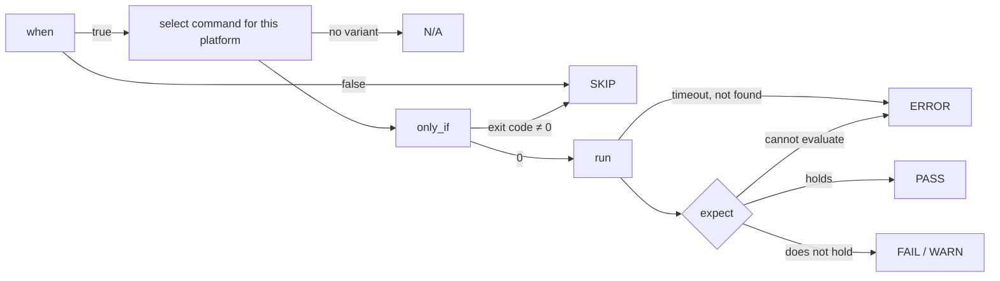

# How checks are evaluated

For every selected check, checkmate goes through these steps:



1. **`when`** is a Jinja2 expression evaluated against facts and variables. If it is false, the check is <span class="st st-skip">SKIP</span>. It can also ask how an earlier check turned out, see [Checks that depend on other checks](../reference/templating.md#checks-that-depend-on-other-checks).
2. **Platform selection**: if `run` has platform variants and none matches this host, the check is <span class="st st-na">N/A</span>.
3. **`only_if`** is a command. If it exits non-zero, the check is <span class="st st-skip">SKIP</span>. Use it for "only if the tool is installed".
4. **`run`** executes the command with a timeout.
5. **`expect`** is evaluated against exit code, stdout and stderr.

## Statuses

| Status | Meaning | Counts as non-compliant |
|---|---|---|
| <span class="st st-pass">PASS</span> | The expectation holds. | no |
| <span class="st st-fail">FAIL</span> | The expectation does not hold, and the severity is at or above the `fail_on` threshold. | **yes** |
| <span class="st st-warn">WARN</span> | The expectation does not hold, but the severity is below the threshold (or `info`). | no |
| <span class="st st-error">ERROR</span> | The check could not be evaluated: timeout, command not found, unexpected exit code, invalid definition. | **yes, always** |
| <span class="st st-skip">SKIP</span> | Excluded by `when` or `only_if`. | no |
| <span class="st st-na">N/A</span> | No command variant for this platform, or a `loop_run` command that printed no items. | no |
| <span class="st st-waived">WAIVED</span> | Failed, warned or errored, but a [waiver](../reference/waivers.md) accepts it with a reason. | no |

## When is a command an error?

checkmate is **fail-closed**: a check must never pass because something went wrong.

- Exit code **126 or 127** (not executable, not found) is always an <span class="st st-error">ERROR</span>.
- A **timeout** is an <span class="st st-error">ERROR</span>. The default timeout is 30 seconds. The command is ended together with every process it started.
- A **`loop_run`** command that fails is an <span class="st st-error">ERROR</span>: a list that cannot be read must never look compliant.
- If `expect` looks at the **output** (`== x`, `empty`, `lines`, …), the command must exit with one of `allow_rc` (default `[0]`). Otherwise the output is meaningless and the check is an <span class="st st-error">ERROR</span>.
- If `expect` looks only at the **exit code** (`true`, `false`, `rc: …`), any exit code is a valid result.

```yaml
# grep exits 1 when nothing matches. That is the good case here,
# so exit code 1 must be allowed:
- id: NO-NOPASSWD
  name: No passwordless sudo rules
  run: grep -rh 'NOPASSWD' /etc/sudoers /etc/sudoers.d
  allow_rc: [0, 1]
  expect: empty
```

## Exit codes

| Code | Meaning |
|---|---|
| `0` | Compliant: no FAIL and no ERROR. |
| `1` | Not compliant: at least one FAIL or ERROR. |
| `2` | Usage error, invalid policy file, no checks selected, or no check evaluated (all skipped or not applicable). |

See [Results, severity and score](../reference/results.md) for thresholds and the score.
