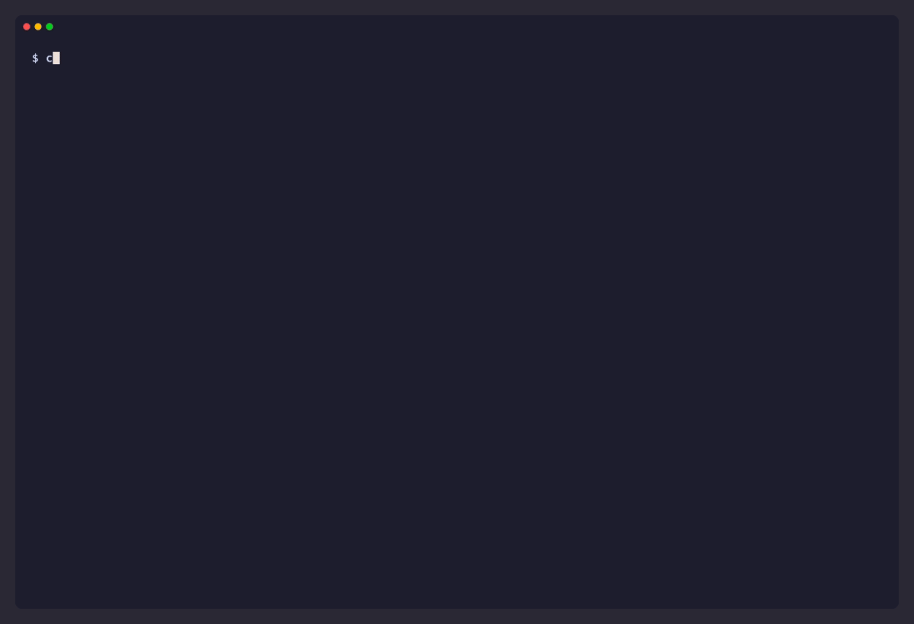

---
hide:
  - navigation
  - toc
---

# checkmate

**Compliance checks as commands.** Every check is a shell command and a condition on its result: written in YAML, readable by anyone who knows a shell, and runnable on Linux, macOS, Windows and against network devices.

```yaml
- id: SSH-001
  name: Root login over SSH is disabled
  severity: high
  run: sshd -T | awk '$1 == "permitrootlogin" {print $2}'
  expect: "== no"
```



<div class="grid cards" markdown>

-   :material-console-line: **Just commands**

    ---

    No plugin per check type. If you can test it in a shell, you can turn it into a check, and copy any command straight into a terminal to debug it.

-   :material-code-braces: **Ansible-style YAML**

    ---

    Jinja2 variables, loops, snippets and facts. One definition can expand into dozens of checks across distributions.

-   :material-shield-check: **Fail-closed**

    ---

    A check that cannot be evaluated is an error, never a pass. Errors always make a run non-compliant.

-   :material-monitor-multiple: **Every platform**

    ---

    One static binary for Linux, macOS and Windows. Platform variants pick the right command for RHEL, Debian, SUSE, macOS or PowerShell.

-   :material-lan: **One host or a whole fleet**

    ---

    The same policy runs locally or over SSH on every host of an [inventory](reference/inventory.md): Linux, macOS, Windows, switches and firewalls. Nothing is installed on the hosts.

-   :material-certificate: **Know what runs**

    ---

    Every run and report names the policy files with their hashes: shipped with checkmate, changed, or your own. [Sign your policies](reference/trust.md) and refuse everything that is not signed.

-   :material-gauge: **Severity and score**

    ---

    Choose which severities fail a run, see warnings for the rest, and track a weighted compliance score.

-   :material-file-chart: **Reports for humans and machines**

    ---

    HTML and PDF for auditors, CSV, JSON Lines and syslog for SIEMs, Prometheus metrics, JUnit for CI, XCCDF/ARF for SCAP tools. Merge the reports of many hosts and [diff](reference/exports.md#checkmate-diff) runs or policies. See [Reports and exports](reference/exports.md).

</div>

## Where to go next

| I want to… | Read |
|---|---|
| install checkmate and run a first policy | [Getting started](getting-started/index.md) |
| look up a key, an operator or a CLI flag | [Reference](reference/index.md) |
| write checks that work everywhere | [Writing robust checks](guides/writing-checks.md) |
| copy a check for SSH, sudo, Docker, a Cisco switch… | [Examples](examples/index.md) |
